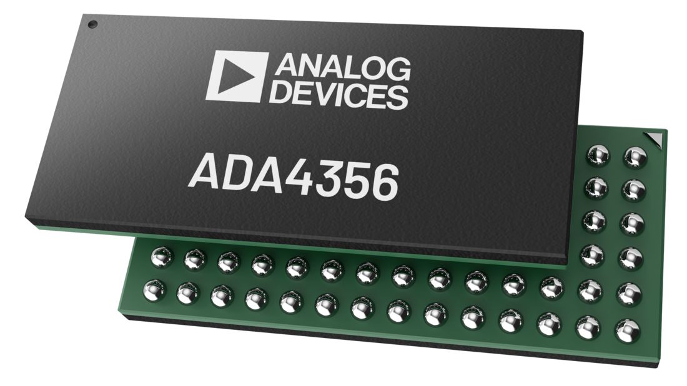
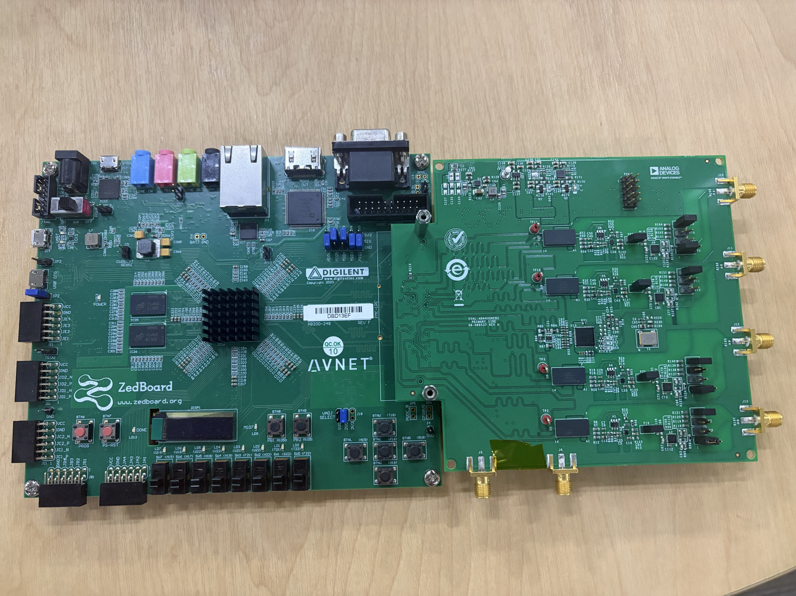

.. _eval-ada4356eb1z:

EVAL-ADA4356EB1Z
===============================================================================

Evaluating the quad-channel ADA4356 Receive uModule.

.. clear-content::

This user guide will discuss how to use the evaluation board and
software to configure and collect data from the EVAL-ADA4356EB1Z
quad-channel board.

Overview
-------------------------------------------------------------------------------

The :adi:`ADA4356` is an integrated receive uModule that combines a
programmable gain transimpedance amplifier (PGTIA), a fully differential
amplifier (FDA), a low-pass filter, and a high-speed ADC in a single
package. It is designed for optical time-domain reflectometry (OTDR),
LiDAR, and fiber sensing applications.

The EVAL-ADA4356EB1Z carries four :adi:`ADA4356` receive uModules
(14-bit, 125 MSPS) with an :adi:`AD9517` clock distribution device, and
is controlled by a ZedBoard FPGA platform running Linux, HDL,
PyADI-IIO, and IIO Oscilloscope.

For the single-channel boards, see :ref:`eval-ada4355-fmc`.

Features:

- Four ADA4356 receive channels on one board
- Programmable gain transimpedance amplifier (PGTIA)
- Fully differential amplifier (FDA)
- Programmable low-pass filter
- Integrated high-speed ADC (14-bit, 125 MSPS) per channel
- AD9517 clock distribution with programmable per-channel delay
- On-board buffered Howland current source (BHCS)

Applications:

- Optical time-domain reflectometry (OTDR)
- LiDAR
- Fiber sensing
- Optical power monitoring

.. toctree::
   :hidden:

   prerequisites
   quickstart/index
   user_guide

Recommendations
-------------------------------------------------------------------------------

People who follow the flow that is outlined have a much better
experience with things. However, like many things, documentation is
never as complete as it should be. If you have any questions, feel
free to ask on our
:ref:`EngineerZone forums <help-and-support>`, but before that,
please make sure you read our documentation thoroughly.

Table of Contents
-------------------------------------------------------------------------------

#. Using the evaluation board/full stack reference design that we
   offer:

   #. :ref:`Prerequisites <eval-ada4356eb1z prerequisites>` - what
      you need to get started
   #. :ref:`Quick start guides <eval-ada4356eb1z quickstart>`:

      #. Using the
         :ref:`ZedBoard <eval-ada4356eb1z quickstart zed>` (FPGA)

   #. :ref:`User guide <eval-ada4356eb1z user-guide>`

#. Use the board to better understand the :adi:`ADA4356`

   #. :external+kuiper:doc:`Configure a SD Card <hardware-configuration>`
   #. :external+kuiper:ref:`package-management`

   #. Linux Applications

      #. :ref:`iio-oscilloscope`
      #. :external+scopy:doc:`Scopy <index>`

#. Design with the ADA4356

   #. HDL software

      #. `QUAD-ADA4356 HDL Reference Design <https://developer.analog.com/docs/hdl/projects/quad_ada4356/index.html>`__

   #. Python software

      #. :git-pyadi-iio:`PyADI-IIO ADA4356 driver <quad_ada4356_py:adi/ada4356_quad.py>`
      #. :git-pyadi-iio:`Quad ADA4356 TDD capture example <quad_ada4356_py:examples/ada4356_quad_tddn_example.py>`
      #. :git-pyadi-iio:`Quad ADA4356 boot alignment example <quad_ada4356_py:examples/ada4356_quad_boot_align.py>`

#. :ref:`Help and Support <help-and-support>`

More Information and Useful Links
-------------------------------------------------------------------------------

- :adi:`ADA4356 Product Page <ADA4356>`
- :adi:`AD9517 Product Page <AD9517>`

Software Projects and Platforms
-------------------------------------------------------------------------------

- :ref:`EVAL-ADA4356EB1Z + ZedBoard <eval-ada4356eb1z quickstart zed>`
- `QUAD-ADA4356 HDL project <https://developer.analog.com/docs/hdl/projects/quad_ada4356/index.html>`__
- :git-pyadi-iio:`PyADI-IIO ADA4356 driver <quad_ada4356_py:adi/ada4356_quad.py>`
- :git-pyadi-iio:`Quad ADA4356 TDD capture example <quad_ada4356_py:examples/ada4356_quad_tddn_example.py>`
- :git-pyadi-iio:`Quad ADA4356 boot alignment example <quad_ada4356_py:examples/ada4356_quad_boot_align.py>`

Warning
-------------------------------------------------------------------------------

.. esd-warning::

Help and support
-------------------------------------------------------------------------------

Please go to :ref:`Help and Support <help-and-support>` page.
