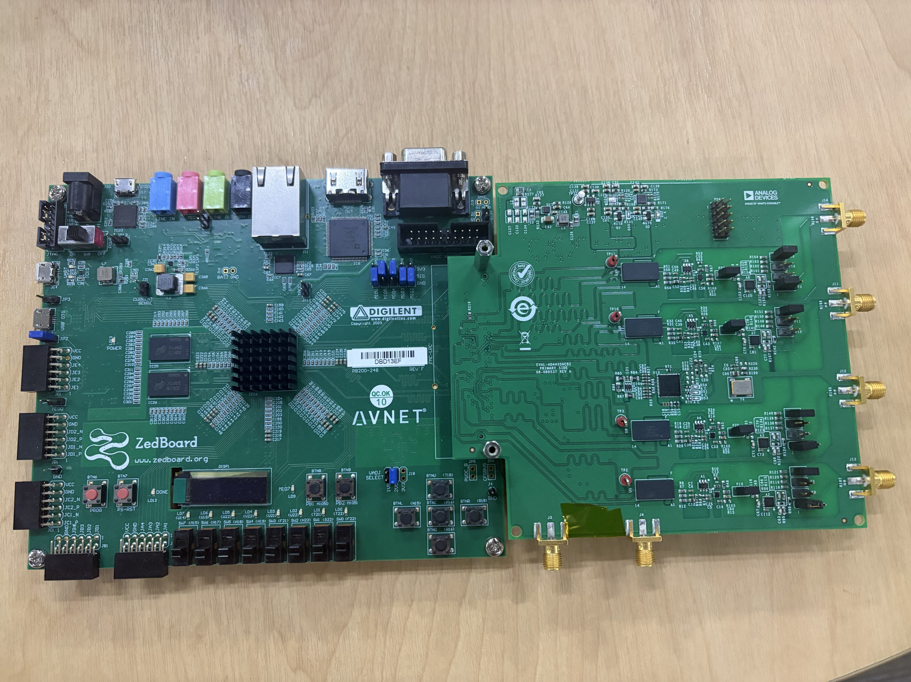

.. _eval-ada4356eb1z quickstart:

Quickstart
===============================================================================

The Quick Start Guide provides simple step by step instructions on
how to do an initial system setup for the :adi:`EVAL-ADA4356EB1Z`
board.

FPGA-based evaluation
~~~~~~~~~~~~~~~~~~~~~~~~~~~~~~~~~~~~~~~~~~~~~~~~~~~~~~~~~~~~~~~~~~~~~~~~~~~~~~~

Use this guide when evaluating with an FPGA carrier board. It
covers SD card preparation, hardware assembly, Linux boot, and
testing with Scopy and IIO Oscilloscope.

.. toctree::

   On ZedBoard <zed>

.. _eval-ada4356eb1z carriers:

Supported carriers
-------------------------------------------------------------------------------

The :adi:`EVAL-ADA4356EB1Z` is an FMC mezzanine card that needs a
carrier to plug into.

The carriers we support are:

.. list-table::
   :header-rows: 1

   - - FPGA board
     - EVAL-ADA4356EB1Z
   - - `ZedBoard <https://digilent.com/reference/programmable-logic/zedboard/start>`__
     - FMC LPC

Supported environments
-------------------------------------------------------------------------------

.. list-table::
   :header-rows: 1

   - - Eval Board
     - FPGA board
     - HDL
     - Linux software
   - - EVAL-ADA4356EB1Z
     - `ZedBoard <https://digilent.com/reference/programmable-logic/zedboard/start>`__
     - `quad_ada4356 <https://developer.analog.com/docs/hdl/projects/quad_ada4356/index.html>`__
     - Yes

Hardware setup
-------------------------------------------------------------------------------

On the ZedBoard, the :adi:`EVAL-ADA4356EB1Z` connects to the FMC LPC
connector. The carrier setup requires power (12 V), Ethernet,
and UART (115200) connections.

