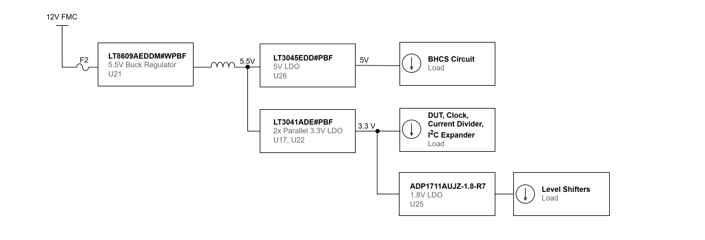
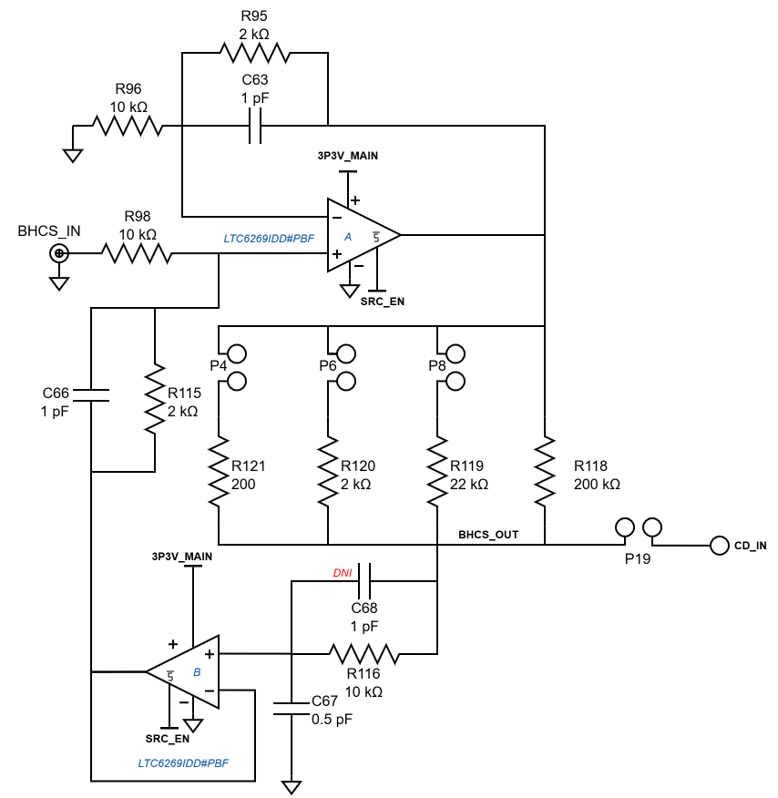
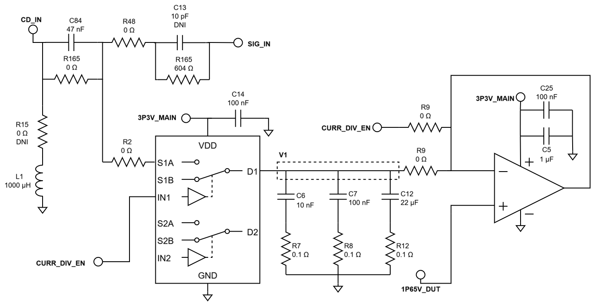
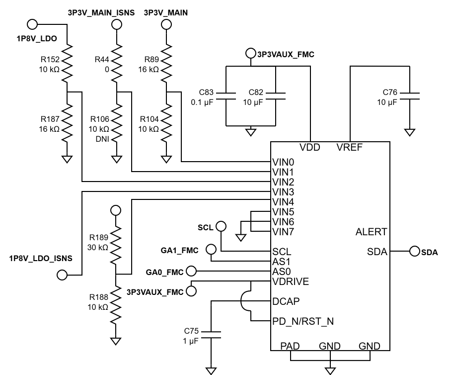
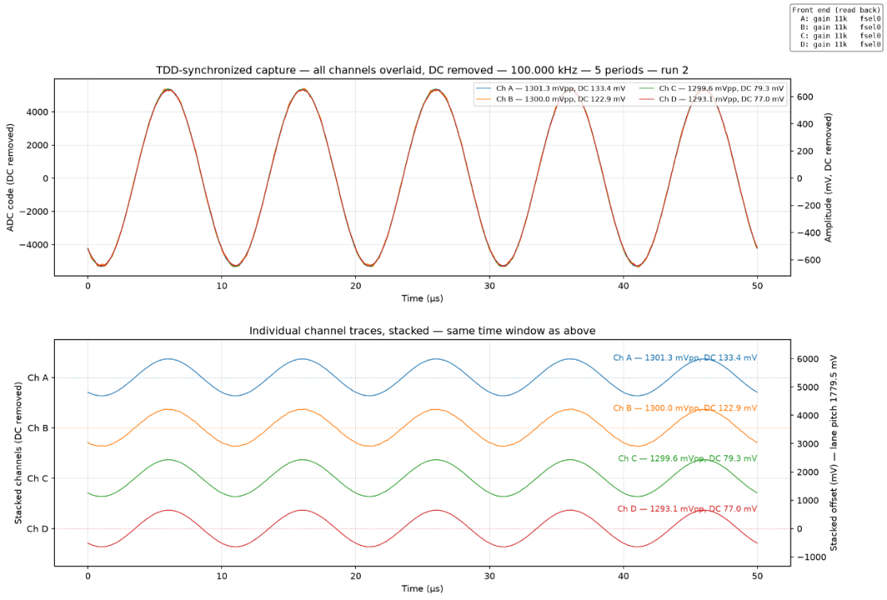
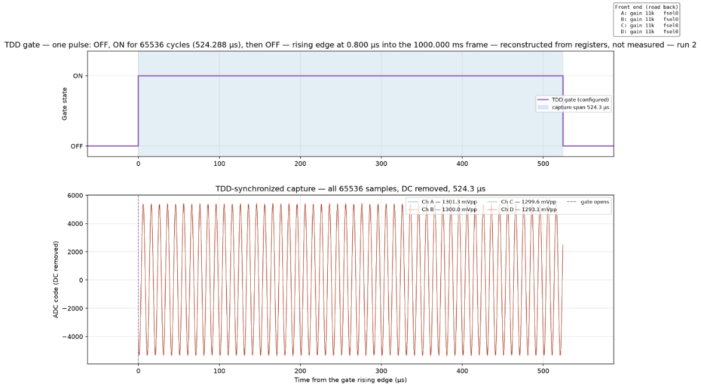
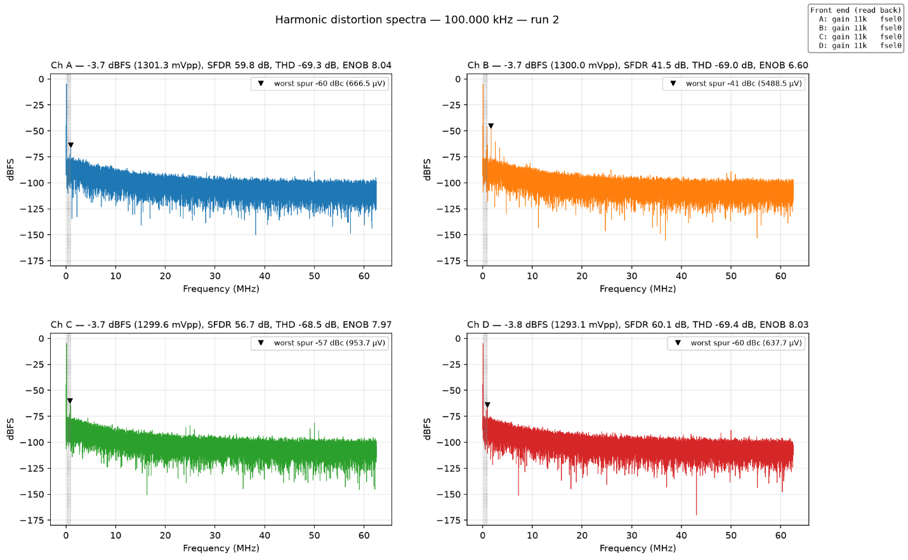
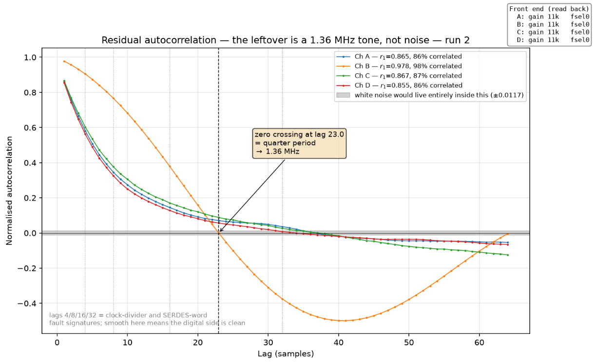

.. _eval-ada4356eb1z user-guide:

User guide
===============================================================================

General description
-------------------------------------------------------------------------------

The EVAL-ADA4356EB1Z is a four-channel evaluation board for the
:adi:`ADA4356` current-input, 14-bit, 125 MSPS data acquisition device. It
lets users evaluate the performance of up to four ADA4356 channels at the
same time, each with an identical signal path. The board plugs into the FMC
connector of a ZedBoard, which supplies the 12 V input power, the digital
control and the data capture path, and it runs under Kuiper Linux with IIO
and PyADI-IIO software support.

Test signals are applied through on-board buffered Howland current sources
(BHCS) driven from SMA connectors, with selectable current ranges of 25 µA,
250 µA, 2.5 mA and 25 mA. A current divider circuit extends the usable input
range, and an APD daughter board interface allows evaluation with a real
optical sensor. The board also provides an :adi:`AD9517-4` low-jitter clock
generator, level shifters, an I²C GPIO expander for programmable gain and
bandwidth selection, a data trigger input and output, and an ADC monitoring
circuit for checking the board supplies.

Features and benefits
-------------------------------------------------------------------------------

- Four independent ADA4356 channels with identical signal paths
- Integrated current-to-bits conversion with minimal external components
- Flexible power solution with on-board and external option
- On-board input signal current divider for current range extension
- Monitor ADC circuitry for quick diagnostic of the board supplies
- Support for multiple input configurations:

  - BHCS circuitry, SMA input voltage
  - External sensor input (APD)

- Flexible control via I²C expansion:

  - Programmable gain and bandwidth
  - Digital shutdown controls for current divider circuit

- Integrated system clock and level shifting circuits
- Expandable architecture through daughter board interface

.. list-table:: Short description and key features
   :header-rows: 1

   - - Key feature
     - Description
   - - BHCS
     - On-board buffered Howland input current source
   - - CDC
     - Current divider circuit
   - - J3
     - Data trigger input
   - - J4
     - Data trigger output
   - - J11
     - BHCS input signal for channel C. Feeds all channels at default
       jumper settings
   - - J12
     - BHCS input signal for channel B
   - - J13
     - BHCS input signal for channel A
   - - J14
     - BHCS input signal for channel D

Evaluation board kit contents
-------------------------------------------------------------------------------

Before powering up the EVAL-ADA4356EB1Z, verify that all jumpers are set to
their default configuration as listed below. Incorrect jumper settings may
cause the board to operate improperly.

.. list-table:: Default jumper connections
   :header-rows: 1

   - - Header
     - Jumper configuration
     - Function
   - - P1, P2, P3
     - Shunt 1-2 (default)
     - BHCS channel C (J11) is the signal used for all channels. See
       :ref:`eval-ada4356eb1z input-configurations`.
   - - P1, P2, P3
     - Shunt 2-3 (not installed)
     - BHCS channel input will be from 4 sources (J11, J12, J13, J14). See
       :ref:`eval-ada4356eb1z input-configurations`.
   - - P8, P9, P12, P17
     - Install shunt
     - Selects 250 µA BHCS current range when installed (default). See
       :ref:`eval-ada4356eb1z bhcs`.
   - - P6, P7, P11, P16
     - No shunt
     - Selects 2.5 mA BHCS current range when installed. See
       :ref:`eval-ada4356eb1z bhcs`.
   - - P4, P5, P10, P13
     - No shunt
     - Selects 25 mA BHCS current range when installed. See
       :ref:`eval-ada4356eb1z bhcs`.
   - - P19, P20, P21, P22
     - Install shunt
     - Connection from BHCS to current divider circuit. Do not remove it
       unless the APD daughter board is used as an input and the BHCS
       amplifiers (:adi:`LTC6269`) are shut down via FMC.

Power supply
-------------------------------------------------------------------------------

   Simplified diagram of power lines and signal path

The figure above shows the simplified diagram of power lines and signal path
across the board. The power supply of the EVAL-ADA4356EB1Z comes directly
and entirely from the ZedBoard 12 V supply pin, passed along through the
board's FMC connector. Given this, a stable mechanical connection between the
ZedBoard and the EVAL-ADA4356EB1Z is required to ensure proper operation.

A fuse is installed between the FMC connector and the rest of the
EVAL-ADA4356EB1Z circuitry, serving as the board's primary line of defense
against unwanted current surge in an event of unintended disruption in
connectivity. The installed fuse, F0603E1R00FSTR, is a fast blow 1 A fuse in
a 0603 SMT package, located in the upper corner of the board, designated as
F2.

The 12 V supply is regulated down to 5.5 V using the :adi:`LT8609`, a
synchronous step-down regulator with more than 93 % efficiency at 1 A,
12 V\ :sub:`IN` to 5.5 V\ :sub:`OUT`. At the LT8609 output, three LDOs are
connected:

#. a 3.3 V supply, which powers the main DUT and the majority of the
   supporting circuitry;
#. a 5 V supply, which is used as the BHCS circuit supply;
#. a 1.8 V supply, which provides the DUT digital logic supply.

A turret test point (TP32) is added at the 5.5 V node (output of LT8609) in
case an external power supply option is preferred. The :adi:`MAX16026`
voltage supervisor ensures that the 3.3 V supply turns on before the 1.8 V
supply, preventing damage to the 1.8 V sensitive SPI lines of the ADA4356.
In addition, the sequencer holds all level shifting circuits in reset,
ensuring that the ADA4356 CSB connections are pulled low at start-up to
select SPI mode for ADC configuration.

.. _eval-ada4356eb1z input-configurations:

Input configurations
-------------------------------------------------------------------------------

The EVAL-ADA4356EB1Z features default BHCS signal connections via SMA,
enabling simple interfacing with standard laboratory equipment. It can also
be expanded using a daughter board if APD or sensor-based inputs are
preferred. BHCS should be used for all initial exercises in this document,
as it provides a controlled and easily adjustable method for evaluation by
converting voltage waveforms into input current for the ADA4356 using
standard waveform generators.

For more application-relevant testing, a daughter board may be used to
interface with real optical sensors, allowing evaluation under realistic
operating conditions.

.. _eval-ada4356eb1z bhcs:

BHCS circuit
~~~~~~~~~~~~~~~~~~~~~~~~~~~~~~~~~~~~~~~~~~~~~~~~~~~~~~~~~~~~~~~~~~~~~~~~~~~~~~~

The on-board current sources are configured as buffered Howland current
sources (BHCS) constructed using a dual op amp, :adi:`LTC6269`. One channel of
the op amp, amplifier A, is set as a difference amplifier, and the other
channel, amplifier B, is set as the output buffer. The circuit accepts a
voltage input through the SMA ports J11 to J14, one per channel. J11 is the
channel C input and, by default, the source for all channels. P1, P2 and P3
can be configured if different sources are used.

   BHCS circuit

The board offers four different current ranges that can be selected by
installing a single jumper per channel, as listed below.

.. list-table:: Current gain configurations
   :header-rows: 1

   - - Current setting
     - Channel A
     - Channel B
     - Channel C
     - Channel D
     - Gain resistor per channel
   - - 25 µA
     - X
     - X
     - X
     - X
     - 200 kΩ
   - - 250 µA
     - P8
     - P9
     - P12
     - P17
     - 22 kΩ
   - - 2.5 mA
     - P6
     - P7
     - P11
     - P16
     - 2 kΩ
   - - 25 mA
     - P4
     - P5
     - P10
     - P13
     - 200 Ω

APD daughter board
~~~~~~~~~~~~~~~~~~~~~~~~~~~~~~~~~~~~~~~~~~~~~~~~~~~~~~~~~~~~~~~~~~~~~~~~~~~~~~~

The APD daughter board connection accommodates prototyping with a physical
sensor by routing signals from the selected APD to the individual channel
inputs. The board can connect a daughter board via connectors P19, P20, P21,
P22 and P24. The on-board current sources (BHCS) must be disconnected to use
this functionality.

P24 is normally unconnected during BHCS operation and is included to allow
the APD daughter board to connect to and communicate with the FMC I²C
interface, enabling adjustment of the APD bias using a digital
potentiometer. Recommended circuit configuration and use assumptions will be
provided upon request.

P19, P20, P21 and P22 provide signal path connectivity from the BHCS to the
current divider circuit (CDC). Removing the shunts allows connection of the
four APD anodes from the daughter board directly to the CDC.

Current divider
~~~~~~~~~~~~~~~~~~~~~~~~~~~~~~~~~~~~~~~~~~~~~~~~~~~~~~~~~~~~~~~~~~~~~~~~~~~~~~~

The current divider circuit, when enabled, divides down the input current
of the selected input source, either the BHCS or the APD, keeping the
resulting current within the 300 µA linear input current range of the
ADA4356 and effectively providing input overcurrent protection. The
:adi:`ADG772` serves as the divider enable switch (typical on resistance of
5 Ω) and the :adi:`LTC6268` as the voltage buffer that charges the capacitors
to the 1.65 V DC bias level using 1P65V_DUT (which comes from TIAREF,
ball F1 of the ADA4356).

The input current I1 comes from CD_IN, which is connected to either BHCS_OUT
or APD_OUT. When S1 closes, I1 is diverted to the AC ground at node V1, where
C15, C18 and C21 are connected. These capacitors shunt this current to
ground. The voltage buffer then rapidly charges the capacitors back up to the
1.65 V DC bias level provided by 1P65V_DUT. This keeps V1 at the DC bias of
the ADA4356 input ball, which this circuit connects to through the SIG_IN
trace.

   Current divider circuit

Clock circuit
-------------------------------------------------------------------------------

The EVAL-ADA4356EB1Z uses the :adi:`AD9517-4` clock generator to provide
low-jitter, phase-aligned synchronized clock signals to each ADA4356
channel. An external 125 MHz CMOS oscillator (CB3LV-3I-125M000000) is used as
the reference input to the AD9517-4 via the REFIN pin. This reference is
multiplied using the AD9517-4 integrated PLL and VCO. The internal VCO is
configured to operate at 1.5 GHz, providing a high-frequency clock source
that enables flexible output division and low phase noise performance
suitable for high-speed photodiode signal acquisition.

The AD9517-4 generates four differential clock outputs on OUT4 through OUT7.
Each output is configured for LVDS signaling. The differential clock traces
are length-matched and impedance-controlled to minimize skew between
channels. The outputs are assigned as follows:

- OUT4 → ADA4356 channel A (CLKP_A/CLKN_A)
- OUT5 → ADA4356 channel B (CLKP_B/CLKN_B)
- OUT6 → ADA4356 channel C (CLKP_C/CLKN_C)
- OUT7 → ADA4356 channel D (CLKP_D/CLKN_D)

Digital interface
-------------------------------------------------------------------------------

The EVAL-ADA4356EB1Z uses the ZedBoard FMC connector to configure the
ADA4356 through the 4-wire SPI, and to receive the ADC data in LVDS mode.

LVDS lines
~~~~~~~~~~~~~~~~~~~~~~~~~~~~~~~~~~~~~~~~~~~~~~~~~~~~~~~~~~~~~~~~~~~~~~~~~~~~~~~

The following table summarizes the LVDS data output connectivity between
the individual channels on the mezzanine card and the carrier board FPGA.

.. list-table:: LVDS lines
   :header-rows: 1

   - - EVB Signal
     - DUT Pin
     - FMC Pin
     - FMC Name
     - ZedBoard Name
     - ZedBoard I/O Bank
   - - DCO_0_P
     - D14
     - D8
     - LA01_P_CC
     - DCO_0_P
     - 34
   - - DCO_0_N
     - D13
     - D9
     - LA01_N_CC
     - DCO_0_N
     - 34
   - - FRAME_0_P
     - C14
     - D11
     - LA05_P
     - FRAME_0_P
     - 34
   - - FRAME_0_N
     - C13
     - D12
     - LA05_N
     - FRAME_0_N
     - 34
   - - D1A_0_P
     - B14
     - C14
     - LA10_P
     - D1A_0_P
     - 34
   - - D1A_0_N
     - B13
     - C15
     - LA10_N
     - D1A_0_N
     - 34
   - - D0A_0_P
     - A14
     - D14
     - LA09_P
     - D0A_0_P
     - 34
   - - D0A_0_N
     - A13
     - D15
     - LA09_N
     - D0A_0_N
     - 34
   - - DCO_1_P
     - D14
     - G6
     - LA00_P_CC
     - DCO_1_P
     - 34
   - - DCO_1_N
     - D13
     - G7
     - LA00_N_CC
     - DCO_1_N
     - 34
   - - FRAME_1_P
     - C14
     - G9
     - LA03_P
     - FRAME_1_P
     - 34
   - - FRAME_1_N
     - C13
     - G10
     - LA03_N
     - FRAME_1_N
     - 34
   - - D1A_1_P
     - B14
     - H13
     - LA07_P
     - D1A_1_P
     - 34
   - - D1A_1_N
     - B13
     - H14
     - LA07_N
     - D1A_1_N
     - 34
   - - D0A_1_P
     - A14
     - G12
     - LA08_P
     - D0A_1_P
     - 34
   - - D0A_1_N
     - A13
     - G13
     - LA08_N
     - D0A_1_N
     - 34
   - - DCO_2_P
     - D14
     - D20
     - LA17_P_CC
     - DCO_2_P
     - 35
   - - DCO_2_N
     - D13
     - D21
     - LA17_N_CC
     - DCO_2_N
     - 35
   - - FRAME_2_P
     - C14
     - D23
     - LA23_P
     - FRAME_2_P
     - 35
   - - FRAME_2_N
     - C13
     - D24
     - LA23_N
     - FRAME_2_N
     - 35
   - - D1A_2_P
     - B14
     - H22
     - LA19_P
     - D1A_2_P
     - 35
   - - D1A_2_N
     - B13
     - H23
     - LA19_N
     - D1A_2_N
     - 35
   - - D0A_2_P
     - A14
     - G21
     - LA20_P
     - D0A_2_P
     - 35
   - - D0A_2_N
     - A13
     - G22
     - LA20_N
     - D0A_2_N
     - 35
   - - DCO_3_P
     - D14
     - C22
     - LA18_P
     - DCO_3_P
     - 35
   - - DCO_3_N
     - D13
     - C23
     - LA18_N
     - DCO_3_N
     - 35
   - - FRAME_3_P
     - C14
     - C26
     - LA27_P
     - FRAME_3_P
     - 35
   - - FRAME_3_N
     - C13
     - C27
     - LA27_N
     - FRAME_3_N
     - 35
   - - D1A_3_P
     - B14
     - H25
     - LA21_P
     - D1A_3_P
     - 35
   - - D1A_3_N
     - B13
     - H26
     - LA21_N
     - D1A_3_N
     - 35
   - - D0A_3_P
     - A14
     - G24
     - LA22_P
     - D0A_3_P
     - 35
   - - D0A_3_N
     - A13
     - G25
     - LA22_N
     - D0A_3_N
     - 35

Level shifters
~~~~~~~~~~~~~~~~~~~~~~~~~~~~~~~~~~~~~~~~~~~~~~~~~~~~~~~~~~~~~~~~~~~~~~~~~~~~~~~

While the EVAL-ADA4356EB1Z HDL firmware has been developed around the
ZedBoard, with its default VADJ set at 2.5 V, the EVAL-ADA4356EB1Z can be
paired with other controller boards as long as an HDL firmware for the
preferred controller is created. The target controller boards must be
SoC-based or must be able to support a soft processor subsystem running
Linux to be compatible with this hardware. The EVAL-ADA4356EB1Z uses an
array of bidirectional level shifters, FXL4TD245BQX, that translate the
digital interface voltage levels to the levels required by the board. The
supply of one side of the level shifter, side B, comes from the controller
board VADJ, while the other supply, side A, is connected to on-board LDOs,
predominantly the 3.3 V supply. The table below lists all the translated
digital signals and the level shifter they are connected to.

.. list-table:: Level-shifted digital signals
   :header-rows: 1

   - - DIGITAL SIGNAL
     - FMC PIN
     - ASSIGNED LEVEL SHIFTER (PIN)
     - DIRECTION
     - COUNTERPART VOLTAGE (V)
   - - SCLK_FMC
     - H4
     - U3 & U5
     - B to A
     - 3.3 &1.8
   - - SDI_FMC
     - H7
     - U3 & U5
     - B to A
     - 3.3 &1.8
   - - SDO_FMC
     - H8
     - U3 & U5
     - A to B
     - 3.3 &1.8
   - - CSB_AD951X_FMC
     - C10
     - U3
     - B to A
     - 3.3
   - - CSB_DUTA_FMC
     - H20
     - U14
     - B to A
     - 1.8
   - - CSB_DUTB_FMC
     - G19
     - U14
     - B to A
     - 1.8
   - - CSB_DUTC_FMC
     - G18
     - U14
     - B to A
     - 1.8
   - - CSB_DUTD_FMC
     - H19
     - U14
     - B to A
     - 1.8
   - - TRIG_FMC_IN
     - H10
     - U12
     - A to B
     - 3.3
   - - TRIG_FMC_OUT
     - H11
     - U12
     - B to A
     - 3.3

I²C GPIO expansion interface
-------------------------------------------------------------------------------

A GPIO expansion interface using the MAX7320 I²C expander supplements the
limited digital I/O available from the FMC connector.

The FPGA GPIO signals available from the FMC interface are insufficient to
control all required board functions. The MAX7320 provides additional
programmable I/O lines over I²C, enabling control of auxiliary signals while
minimizing direct FMC pin usage. All digital signals connected to it are
3.3 V. The signals interfaced to the MAX7320 devices are listed below.

.. list-table:: MAX7320 signals
   :header-rows: 1

   - - Digital signal
     - Assigned MAX7320
     - Output pin
     - I²C address
     - Counterpart voltage (V)
   - - CURR_DIV_ENA
     - U15
     - O4
     - 0x5D
     - 3.3
   - - GSEL0_A
     - U15
     - O5
     - 0x5D
     - 3.3
   - - GSEL1_A
     - U15
     - O6
     - 0x5D
     - 3.3
   - - FREQ_SEL_A
     - U15
     - O7
     - 0x5D
     - 3.3
   - - CURR_DIV_ENB
     - U15
     - O0
     - 0x5D
     - 3.3
   - - GSEL0_B
     - U15
     - O1
     - 0x5D
     - 3.3
   - - GSEL1_B
     - U15
     - O2
     - 0x5D
     - 3.3
   - - FREQ_SEL_B
     - U15
     - O3
     - 0x5D
     - 3.3
   - - CURR_DIV_ENC
     - U16
     - O4
     - 0x5E
     - 3.3
   - - GSEL0_C
     - U16
     - O5
     - 0x5E
     - 3.3
   - - GSEL1_C
     - U16
     - O6
     - 0x5E
     - 3.3
   - - FREQ_SEL_C
     - U16
     - O7
     - 0x5E
     - 3.3
   - - CURR_DIV_END
     - U16
     - O0
     - 0x5E
     - 3.3
   - - GSEL0_D
     - U16
     - O1
     - 0x5E
     - 3.3
   - - GSEL1_D
     - U16
     - O2
     - 0x5E
     - 3.3
   - - FREQ_SEL_D
     - U16
     - O3
     - 0x5E
     - 3.3
   - - SRC_EN_A
     - U4
     - O4
     - 0x59
     - 3.3
   - - SRC_EN_B
     - U4
     - O5
     - 0x59
     - 3.3
   - - SRC_EN_C
     - U4
     - O6
     - 0x59
     - 3.3
   - - SRC_EN_D
     - U4
     - O7
     - 0x59
     - 3.3

Data trigger
-------------------------------------------------------------------------------

A data trigger signal is provided on the EVAL-ADA4356EB1Z to allow for a more
efficient data capture. The input trigger SMA, J3, tells the ADA4356 that a
pulse is expected to come, thereby toggling the device to capture mode. If a
data trigger signal is generated via software or on the ZedBoard, the output
trigger SMA, J4, allows monitoring of the trigger signal being sent to the
ADA4356 for debugging purposes.

ADC monitoring circuit
-------------------------------------------------------------------------------

The :adi:`AD7291` monitors the board supplies and is read through the
available IIO drivers. It is powered by the ZedBoard 3.3 V auxiliary pin, and
each of its channels reads the voltage output of an on-board or on-chip LDO.
Since the AD7291 internal voltage reference is 2.5 V, the supply readings are
scaled down via voltage dividers, as listed below.

   ADC monitoring circuit

.. list-table:: ADC monitor
   :header-rows: 1

   - - Supply name
     - Voltage divider resistors
     - Scale (V)
     - Scaled output (V)
   - - 3P3V_MAIN
     - R89 = 16 kΩ, R104 = 10 kΩ
     - 0.6158
     - 1.2692
   - - 3P3V_MAIN_ISNS
     - R44 = 0 Ω, R106 = DNI
     - \-
     - 1.25
   - - 1P8V_LDO
     - R152 = 10 kΩ, R167 = 16 kΩ
     - 0.3846
     - 1.1077
   - - 1P8V_LDO_ISNS
     - No divider. V\ :sub:`REF` is set to 1.25 V
     - \-
     - 1.25
   - - 5V_BHCS
     - R189 = 30 kΩ, R188 = 10 kΩ
     - 0.25
     - 1.25

Software
-------------------------------------------------------------------------------

IIO driver
~~~~~~~~~~~~~~~~~~~~~~~~~~~~~~~~~~~~~~~~~~~~~~~~~~~~~~~~~~~~~~~~~~~~~~~~~~~~~~~

The board appears as one IIO context. List its devices with:

.. shell::

   $iio_attr -u ip:<board> -d

The list must include ``ada4356-a``, ``ada4356-b``, ``ada4356-c``,
``ada4356-d``, ``adi-iio-fakedev`` (the TDD core, device-tree label
``axi-core-tdd``) and ``ad9517-4`` (the clock generator, needed for the
clock trim).

PyADI-IIO examples
~~~~~~~~~~~~~~~~~~~~~~~~~~~~~~~~~~~~~~~~~~~~~~~~~~~~~~~~~~~~~~~~~~~~~~~~~~~~~~~

Requirements on the host PC: Python 3.11 or later, libiio 0.26
(``iio_info -V``), and the PyADI-IIO checkout of the ``quad_ada4356_py``
branch, which contains the
:git-pyadi-iio:`adi/ada4356_quad.py <quad_ada4356_py:adi/ada4356_quad.py>`
driver, installed in a virtual environment with ``pip install -e .``.

.. list-table::
   :header-rows: 1

   - - Script (``pyadi-iio/examples/``)
     - Purpose
   - - :git-pyadi-iio:`ada4356_quad_tddn_example.py <quad_ada4356_py:examples/ada4356_quad_tddn_example.py>`
     - 4-channel capture gated by the TDD engine: SNR, THD, SFDR, SINAD,
       ENOB, harmonics, residual autocorrelation, inter-channel skew, voltage
       tables, stacked per-channel plots, a THD plot, a TDD gate plot, a
       numbered ``.txt`` log, and optional CSV output. ``--align`` runs the
       boot alignment first.
   - - :git-pyadi-iio:`ada4356_quad_boot_align.py <quad_ada4356_py:examples/ada4356_quad_boot_align.py>`
     - Run after every power cycle, gain/filter change or clock sync, with
       the same tone on all four inputs (J11 feeds all channels at default
       jumper settings). Measures the skew of channels B, C and D against
       A, trims the AD9517 clock delays, applies a whole-sample software
       shift, and re-measures. See :ref:`eval-ada4356eb1z boot-align`.

Python API (``adi.ada4356_quad``). The TDD core must be configured and
enabled before ``calibrate_alignment()`` or ``rx()`` is called, as done by
``setup_tdd()`` in ``ada4356_quad_tddn_example.py``:

.. code-block:: python

   import adi
   from adi.ada4356_quad import ALIGN_GUARD

   samples = 65536
   dev = adi.ada4356_quad(uri="ip:192.168.2.1")
   dev.gain_mode = "11k"            # all four channels
   dev.filter_mode = "fsel0"
   dev.rx_buffer_size = samples

   # TDD: channel 0 off, channels 1 to 4 gate the four DMAs
   tdd = dev.tdd
   tdd.enable = False
   tdd.burst_count = 0
   tdd.frame_length_raw = 125_000_000   # 1 s frame at the 125 MHz TDD clock
   tdd.channel[0].enable = False
   for ch_idx in range(1, 5):
       tdd.channel[ch_idx].on_raw = 100
       tdd.channel[ch_idx].off_raw = 100 + samples + ALIGN_GUARD
       tdd.channel[ch_idx].enable = True
   tdd.enable = True
   try:
       tdd.sync_soft = True
   except Exception:
       pass

   dev.calibrate_alignment(100e3)   # optional, needs the same tone on all inputs
   data = dev.rx()                  # list of 4 numpy arrays
   volts = [d / 8192 for d in data]

Without ``calibrate_alignment()``, ``rx()`` returns ADC codes.
``calibrate_alignment()`` defaults to ``subsample=True``: after it, ``rx()``
returns float64 data that is shifted and interpolated (windowed-sinc FIR) to
remove the sub-sample delay, not raw codes. Pass ``subsample=False`` for a
whole-sample shift only, without filtering. ``ALIGN_GUARD`` keeps the gate
open for the extra samples an aligned capture reads.

One-time setup for running Python examples
^^^^^^^^^^^^^^^^^^^^^^^^^^^^^^^^^^^^^^^^^^^^^^^^^^^^^^^^^^^^^^^^^^^^^^^^^^^^^^^

#. Find the board IP address. On the ZedBoard serial console, run
   ``ifconfig`` and note the ``inet`` address of ``eth0``
   (e.g. 192.168.2.1).
#. Check that the PC can see the board. In PowerShell:

   .. code-block:: powershell

      iio_attr -u ip:<BOARD_IP> -d

   The list must include ``ada4356-a``, ``-b``, ``-c``, ``-d``,
   ``adi-iio-fakedev`` (TDD core) and ``ad9517-4``.
#. Create a Python virtual environment. This is a private Python install
   just for this tool, so it doesn't interfere with anything else on the PC:

   .. code-block:: powershell

      python -m venv C:\venv-adi
      C:\venv-adi\Scripts\Activate.ps1

   The prompt now starts with ``(venv-adi)``.
#. Download the ``quad_ada4356_py`` branch of PyADI-IIO into
   ``C:\Users\<you>\pyadi-iio``. The ``main`` branch does not contain the
   quad driver:

   .. code-block:: powershell

      cd C:\Users\<you>
      git clone -b quad_ada4356_py https://github.com/analogdevicesinc/pyadi-iio.git

#. Install PyADI-IIO and its dependencies from the ``pyadi-iio`` folder:

   .. code-block:: powershell

      cd C:\Users\<you>\pyadi-iio
      pip install -e .
      pip install numpy matplotlib

Running a capture using Python
^^^^^^^^^^^^^^^^^^^^^^^^^^^^^^^^^^^^^^^^^^^^^^^^^^^^^^^^^^^^^^^^^^^^^^^^^^^^^^^

Every time, open PowerShell and activate the environment:

.. code-block:: powershell

   C:\venv-adi\Scripts\Activate.ps1
   cd C:\Users\<you>\pyadi-iio

Run ``ada4356_quad_tddn_example.py`` with the following parameters:

.. code-block:: powershell

   python examples\ada4356_quad_tddn_example.py ip:<board ip> <buffer size> <test tone> <gain> <filter> [options]

All arguments are optional. Options such as ``--align shift`` or ``--csv``
go before or after all the positional arguments, not between them. See
:ref:`eval-ada4356eb1z sampling` for the full list, or run:

.. code-block:: powershell

   python examples\ada4356_quad_tddn_example.py -h

Outputs are written to ``%TEMP%\ada4356_quad_tddn_example_outputs\``. The
run number ``N`` is the lowest number not already used by a file in the
output folder:

.. list-table::
   :header-rows: 1

   - - File
     - Content
   - - ``ada4356_quadN.png``
     - TDD-synchronized capture (top) and stacked per-channel traces
       (bottom). Shows 5 periods by default.
   - - ``ada4356_quadN_thd.png``
     - Harmonic content per channel
   - - ``ada4356_quadN_diag.png``
     - Diagnostics
   - - ``ada4356_quadN_gate.png``
     - TDD gate pulse above the capture. Shows the whole record by default,
       or the ``--duration`` window
   - - ``ada4356_quadN.txt``
     - Full console log
   - - ``ada4356_quadN_samples.csv``, ``ada4356_quadN_metrics.csv``
     - Only with ``--csv``

Demonstration example
^^^^^^^^^^^^^^^^^^^^^^^^^^^^^^^^^^^^^^^^^^^^^^^^^^^^^^^^^^^^^^^^^^^^^^^^^^^^^^^

The command
``python examples\ada4356_quad_tddn_example.py ip:192.168.2.1 65536 100000 11k fsel0``
connects to the board at 192.168.2.1, reads 65536 samples of a 100 kHz input
signal, and sets the ADA4356 front end to 11 kΩ gain with the ``fsel0``
filter.

#. Configure the function generator with the following parameters:

   - Signal type: Sine wave
   - Frequency: 100 kHz
   - Amplitude: 120 mVpp
   - DC offset: 40 mV
   - Output load: HiZ
   - BHCS current setting: 25 mA for all channels (see
     :ref:`eval-ada4356eb1z bhcs`)

#. Connect the output of the function generator to J11 of the
   EVAL-ADA4356EB1Z, the channel C SMA input, which goes to all channels at
   default jumper settings.
#. Turn on the signal generator, then run:

   .. code-block:: powershell

      python examples\ada4356_quad_tddn_example.py ip:192.168.2.1 65536 100000 11k fsel0

Examples of expected outputs:

   TDD-synchronized capture and stacked per-channel traces

   TDD gate and full-record capture

   Harmonic distortion spectra

   Diagnostics: residual autocorrelation

.. _eval-ada4356eb1z boot-align:

Aligning the channels
^^^^^^^^^^^^^^^^^^^^^^^^^^^^^^^^^^^^^^^^^^^^^^^^^^^^^^^^^^^^^^^^^^^^^^^^^^^^^^^

``ada4356_quad_boot_align.py`` needs the same tone on all four inputs (J11
at default jumper settings). Its default URI is ``ip:192.168.0.102``, so
always pass the board address:

.. code-block:: powershell

   python examples\ada4356_quad_boot_align.py ip:192.168.2.1 --tone 100000 --gain 11k --filter fsel0

.. list-table::
   :header-rows: 1

   - - Option
     - Default
     - Function
   - - ``uri`` (positional)
     - ``ip:192.168.0.102``
     - IIO context of the board
   - - ``--tone``
     - ``100e3``
     - Tone frequency on the inputs, in Hz
   - - ``--samples``
     - ``65536``
     - Buffer size of each capture
   - - ``--gain``
     - ``11k``
     - Transimpedance gain written to all four channels
   - - ``--filter``
     - ``fsel1``
     - Front-end filter written to all four channels
   - - ``--captures``
     - ``5``
     - Captures averaged per measurement
   - - ``--settle``
     - ``1.0``
     - Wait in seconds after a clock-delay change, before measuring
   - - ``--target-ns``
     - ``0.3``
     - Residual skew, in ns, above which a channel is reported as above
       target
   - - ``--no-trim``
     - Off
     - Skip the AD9517 clock trim
   - - ``--no-align``
     - Off
     - Skip the whole-sample software shift
   - - ``--restore``
     - Off
     - Put the clock delays back in bypass on exit

The script always writes the gain and filter, using the defaults ``11k`` and
``fsel1`` when ``--gain`` and ``--filter`` are not given. To keep the current
front-end setting, pass it with ``--gain`` and ``--filter``.

The whole-sample software shift exists only inside the boot-align process.
The AD9517 clock trim stays applied after the script exits, until the next
reboot or a run with ``--restore``. For a capture with the alignment
applied, run ``ada4356_quad_tddn_example.py`` with ``--align shift``,
``--align trim`` or ``--align interp``, which runs the alignment stages in
the same process as the capture.

The script saves two plots, ``/tmp/ada4356_boot_align.png`` and
``/tmp/ada4356_boot_align_diag.png``. These paths are fixed in the script.

Configuring the hardware
~~~~~~~~~~~~~~~~~~~~~~~~~~~~~~~~~~~~~~~~~~~~~~~~~~~~~~~~~~~~~~~~~~~~~~~~~~~~~~~

.. list-table::
   :header-rows: 1

   - - Setting
     - Values
     - How to set
     - Default at boot
   - - Transimpedance gain
     - ``133k``, ``11k``, ``4k54``
     - 4th script argument
     - ``11k``
   - - Front-end filter
     - ``fsel0``, ``fsel1``
     - 5th script argument
     - ``fsel1``
   - - Current divider
     - CURR_DIV_EN_A, B, C, D
     - No IIO control. Device-tree hog only (``i2cset`` on 0x5D/0x5E for
       test purposes)
     - LOW
   - - Source enable
     - SRC_EN_A, B, C, D
     - Device-tree hog on 0x59
     - HIGH

The script arguments apply the setting to all four channels. To set one
channel only, use ``iio_attr`` on that channel's device before running. The
script reads back and prints the value of every channel.

.. _eval-ada4356eb1z sampling:

Sampling configuration
~~~~~~~~~~~~~~~~~~~~~~~~~~~~~~~~~~~~~~~~~~~~~~~~~~~~~~~~~~~~~~~~~~~~~~~~~~~~~~~

.. list-table::
   :header-rows: 1

   - - Parameter
     - Fixed / settable
     - Value
   - - Sample rate
     - Fixed by AD9517 OUT4–OUT7 and the bitstream
     - 125 MSPS
   - - Resolution / format
     - Fixed
     - 14-bit, two's complement, ``le:s14/16>>2``
   - - Buffer size
     - 2nd script argument
     - Default 65536 (= 524.288 µs). Upper limit set by the ZedBoard CMA
       reserve (``dmesg | grep -i cma``)
   - - Test tone
     - 3rd script argument (Hz)
     - Equal to input signal frequency
   - - TDD frame
     - ``--frame``
     - ``buffer``, a cycle count, or a time such as ``250ms``. Default 1 s
   - - Plot periods
     - ``--periods``
     - Tone periods in the time-domain panels of ``ada4356_quadN.png``.
       Default 5. ``all``, ``full`` and ``0`` are ignored (5 periods are
       kept); ``ada4356_quadN_gate.png`` shows the whole record
   - - Gate plot window
     - ``--duration``
     - Time window of ``ada4356_quadN_gate.png``, e.g. ``500us``. Default:
       the whole record. The part past the end of the record is drawn as no
       data
   - - Output folder
     - ``--outdir``
     - Default ``%TEMP%\ada4356_quad_tddn_example_outputs``
   - - CSV export
     - ``--csv``
     - Off by default
   - - Suppress pop-ups
     - ``--no-show``
     - Off by default
   - - Channel alignment
     - ``--align``
     - ``off``, ``shift``, ``trim``, ``interp``. Default ``off``

Example: ``python examples\ada4356_quad_tddn_example.py ip:192.168.2.1 65536 100000 11k fsel0 --align shift --csv --outdir C:\ada_out``

Each option can also be set with the matching ``ADA4356_*`` environment
variable (for example ``$env:ADA4356_CSV = "1"``). Clear them with
``Remove-Item Env:ADA4356_*``. ``ADA4356_CSV`` turns CSV export on only when
set to ``1``, ``true``, ``yes``, ``on``, ``both``, ``all``, ``samples`` or
``metrics`` (not case-sensitive). ``ADA4356_NO_SHOW`` turns pop-ups off only
when set to ``1``, ``true`` or ``True``. Any other value leaves the option
off. Once turned on by the variable, no command-line option turns it back
off.
